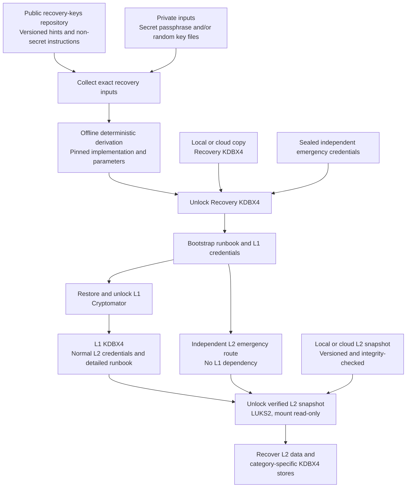

# Recovery Key Lifecycle

## Overview

Recover encrypted L1 and L2 data using versioned public hints, private recovery inputs, and a reproducible offline derivation process. Maintain an **independent emergency route** that does not require internet access, the normal derivation tool, or a working L1 container.

> **Public-document warning:** This guide describes the architecture only. No actual passwords, security-question answers, private key files, recovery codes, identifying contact details, or physical key locations are included.

## Data and key stores

| Layer | Purpose | Storage | Recovery role |
| --- | --- | --- | --- |
| **Recovery KDBX4** (bootstrap) | Initial recovery credentials and instructions | Independently backed up locally and in cloud storage | Unlock L1; identify matching backup versions; provide or locate an independent emergency route to L2 |
| **L1** | Personal data plus protected recovery infrastructure | Cryptomator vault, incremental local/cloud backups | Holds the **L1 KDBX4** and detailed L2 recovery runbook |
| **L1 KDBX4** (secondary) | Normal L2 recovery credentials and instructions | Inside L1 Cryptomator vault | Unlock the matching L2 snapshot, if L1 is available |
| **L2** | Highly sensitive data | LUKS2 encrypted volume, versioned local/cloud snapshots | Contains independent category-specific KDBX4 databases |
| **L2 category KDBX4** | Category-specific credentials | Inside L2 | Open only after L2 is mounted |

**Security boundary:** L1 must be treated as sensitive because it holds L2 recovery material. L2 must never be the only place containing information required to unlock L2.

## Architecture



**Normal path:** Recovery KDBX4 → L1 Cryptomator → L1 KDBX4 → L2 LUKS2 → category KDBX4.

**Emergency path:** Independently available recovery materials → L2 emergency LUKS2 keyslot → L2, even when L1 is missing or damaged.

## Key lifecycle

1. **Prepare:** Publish only non-secret hints, protocol versions, and general instructions to GitHub/Bitbucket. Preserve an offline copy of the exact referenced revision, private inputs, tested tools, and dependencies.
2. **Generate:** Derive the **Recovery KDBX4** password with a version-pinned, deterministic process. SHA-512 alone does not make guessable inputs strong; use at least one high-entropy private secret. Document input bytes, ordering, encoding, normalization, algorithm, parameters, and output encoding.
3. **Protect:** Create the Recovery KDBX4 and store independently recoverable copies locally and in the cloud. Keep a sealed emergency credential separately. Record how to unlock L1 without relying on L1 itself.
4. **Back up L1:** Make a consistent, verified incremental backup of the Cryptomator vault, including the L1 KDBX4 and detailed L2 runbook. Preserve enough vault metadata and historical versions for restoration.
5. **Back up L2:** Create a consistent, verified LUKS2 snapshot; retain a protected header backup and a separately tested emergency LUKS2 keyslot. Archive matching L2 recovery instructions and private inputs.
6. **Distribute:** Maintain geographically separated offline recovery kits and encrypted cloud copies. Give the trusted person clear authorization, a printed bootstrap guide, and access to the intended emergency credentials under the chosen custody model.
7. **Rotate:** When updating hints, credentials, or snapshots, assign a new recovery version. Record the matching Recovery KDBX4, L1 vault backup, L1 KDBX4, L2 snapshot, KDF parameters, and LUKS keyslots. Keep the previous fully tested generation until the new one passes restoration tests.
8. **Recover:** On a verified machine, retrieve a matching backup generation, check integrity, open Recovery KDBX4, restore L1 when possible, and unlock L2 using either the L1 KDBX4 or the independent emergency route. Mount recovered data read-only before copying it to a safe destination.
9. **Test:** At least twice yearly, test offline recovery from a spare computer; periodically have the trusted person complete a supervised drill with test credentials and test data. Test the **L1-unavailable** scenario explicitly.

## Version manifest (non-secret example)

```yaml
recovery_version: '2026-11'
public_hints_revision: '<git-commit-id>'
derivation_protocol: 'RECOVERY-KDF-V2'
recovery_kdbx_version: '2026-11'
l1_backup_version: '2026-11'
l1_kdbx_version: '2026-11'
l2_snapshot_version: '2026-11'
l2_luks_header_version: '2026-11'
last_tested: '<YYYY-MM-DD>'
```

Do not include credentials or private key-file contents in this manifest. Store an authenticated integrity manifest alongside trusted recovery documentation.

## Important safeguards

- **Avoid circular dependencies:** The Recovery KDBX4 and emergency L2 unlock method must be available without opening L1 or L2.
- **KDBX4 is an encrypted database format, not a second authentication factor by itself.** Independence depends on separate credentials and custody. A KDBX key file or additional factor must be backed up separately if required.
- **Do not assume a new LUKS snapshot changes its passphrase.** Change and test the appropriate LUKS keyslot deliberately when rotating credentials.
- **Protect LUKS headers:** Store encrypted header backups securely; old header copies can preserve older keyslot information.
- **Version complete recovery sets:** A newer hint file must not silently replace the instructions for an older snapshot.
- **Use reproducible cryptography:** The pinned tool must reproduce identical output from identical inputs; randomly salted password hashes are not directly reproducible unless the salt and exact parameters are retained.
- **Treat public hints as public:** Their secrecy contributes no entropy. Do not rely solely on personal facts or public-file checksums for the final secret.
- **Validate backup consistency and integrity:** Test Cryptomator restoration, KDBX opening, LUKS unlocking, and representative file reads, not only checksums.
- **Keep offline copies:** Do not rely on Google, GitHub, Bitbucket, a password-manager service, or CDN-hosted scripts in a disaster.
- **Protect the trusted person:** Document when access is authorized, how emergency credentials are stored, and how to rotate them after use.
