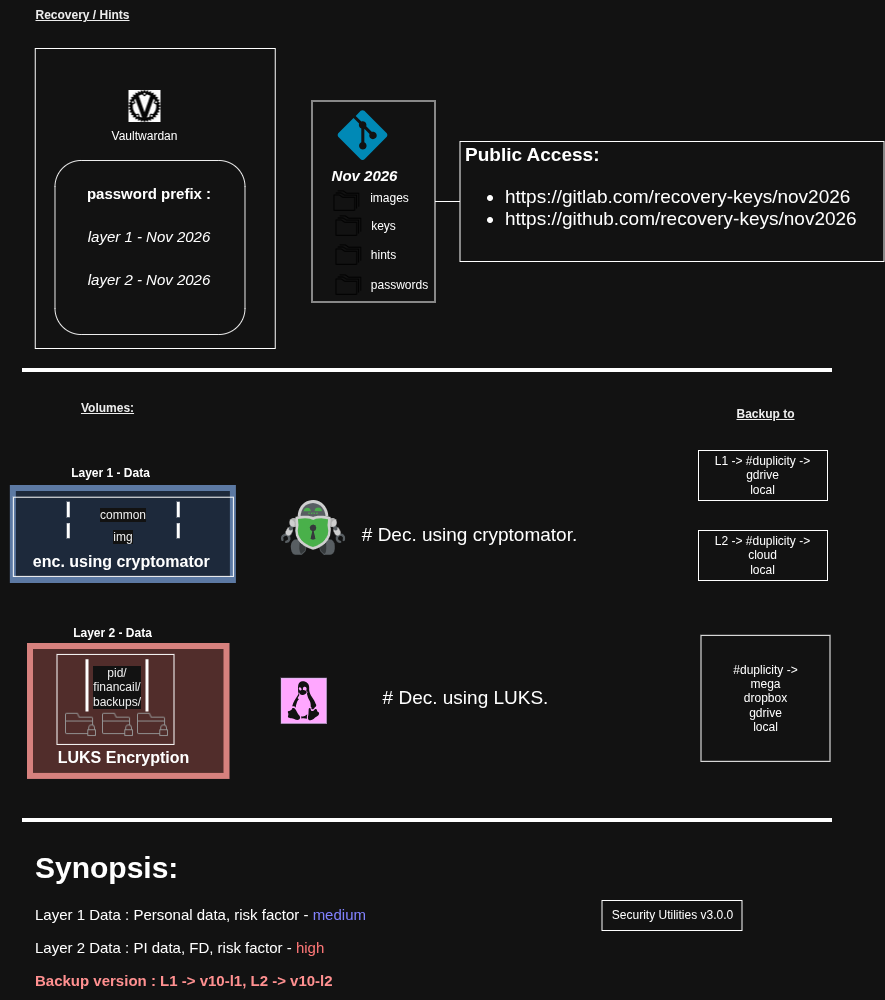

# Content Manamgent:

## Backup version : 
- L1 -> v10-l1
- L2 -> v10-l2

## Generate Passwords :
- read the `hints` and `q&a.md` to find the correct password combinations.
- use the `Security Utilities v3.0.0` to generate password `hash` with correct number of `iterations`.

## Content generation process:
- Read `Recovery Keys - Key Rotation process:`.

